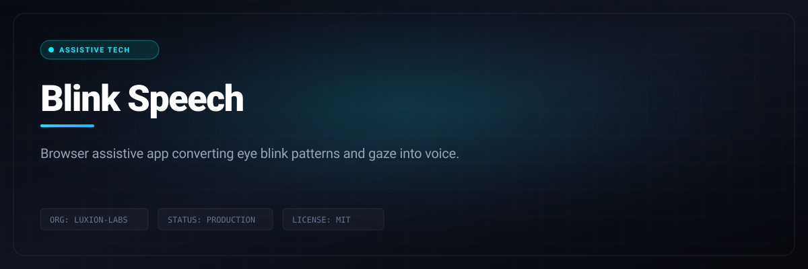

# Blink Speech

> Browser assistive app converting eye blink patterns and gaze into voice.

```bash
git clone https://github.com/Luxion-Labs/Blink-Speech.git && cd Blink-Speech && npm install && npm run dev
```



[](https://blink-speech.vercel.app) [](LICENSE) [](CONTRIBUTING.md)

## Overview
Browser assistive app converting eye blink patterns and gaze into voice. Built by Luxion Labs as part of our high-velocity open-source engineering ecosystem.

## Features
- Pure client-side computer vision without sending video frames to servers.
- Morse and duration-coded blink sequence decoding into natural speech.
- Fully responsive accessibility-first UI with high-contrast themes.
- Low latency audio synthesis using native browser speech engines.

## Architecture and Stack
Next.js, TypeScript, MediaPipe FaceMesh, Web Speech API, and Tailwind CSS.

## Quickstart
```bash
git clone https://github.com/Luxion-Labs/Blink-Speech.git && cd Blink-Speech && npm install && npm run dev
```

## Maintainer Response SLA
Luxion Labs enforces a strict 24-hour response SLA on all community issues, feature proposals, and pull requests. See [CONTRIBUTING.md](CONTRIBUTING.md) for full development guidelines.

## License
Distributed under the MIT License. See [LICENSE](LICENSE) for more details.
